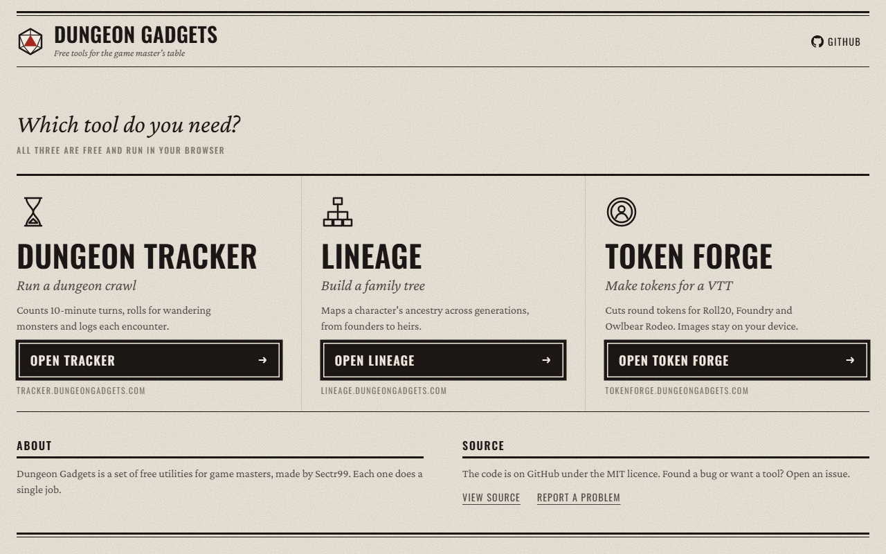
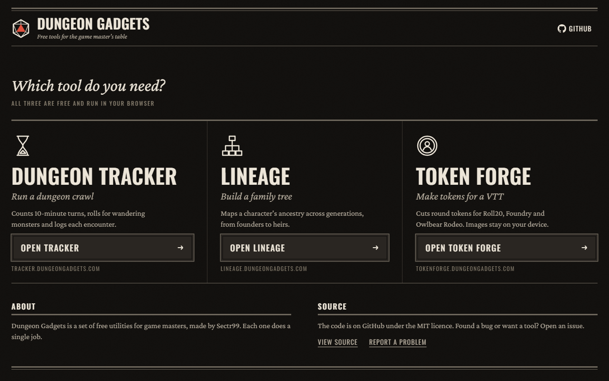
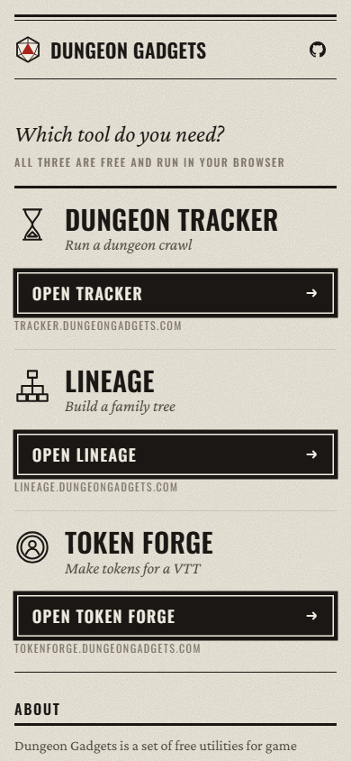
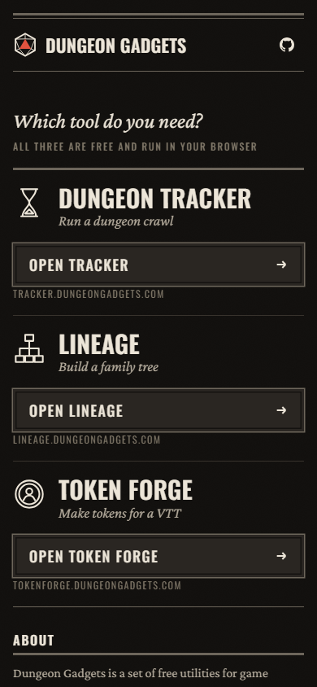

# Dungeon Gadgets

The home page for [Dungeon Gadgets](https://dungeongadgets.com/), a set of free browser tools for tabletop game masters. It does one thing: send you to the tool you need.

## Tools

| Tool | Address | What it does |
|------|---------|--------------|
| **Dungeon Tracker** | [tracker.dungeongadgets.com](https://tracker.dungeongadgets.com/) | Counts 10-minute turns, rolls for wandering monsters and logs each encounter. |
| **Lineage** | [lineage.dungeongadgets.com](https://lineage.dungeongadgets.com/) | Maps a character's ancestry across generations. |
| **Token Forge** | [tokenforge.dungeongadgets.com](https://tokenforge.dungeongadgets.com/) | Cuts round tokens for Roll20, Foundry and Owlbear Rodeo. Images stay on your device. |

Each tool lives in its own repository and deploys to its own subdomain.

## Light, dark and phone

The page follows the system colour scheme. Below 920px the three panels stack so every Open button fits on the first screen.

| Dark | Phone (light) | Phone (dark) |
|------|---------------|--------------|
|  |  |  |

## By the numbers

| | |
|---|---|
| Files deployed | 1 (`dist/index.html`) |
| Page size | 16.4 KB, 4.9 KB gzipped |
| JavaScript | None of its own |
| Images | None; the d20 logo and tool icons are inline SVG |
| Fonts | Oswald and Crimson Pro (Google Fonts, served by Cloudflare) |
| Build step | None |
| Colour schemes | Light and dark |

## Design

The page uses the shared DungeonTools style, the same as Dungeon Tracker: ink on bone paper, ruled like a printed rulebook, one red reserved for the d20. Oswald capitals carry structure; Crimson Pro carries anything you read. No gradients, shadows or animation.

## Security

A Content-Security-Policy meta tag in `dist/index.html` limits the page to:

- styles from itself and Google Fonts
- fonts from itself (Cloudflare re-hosts the Google Fonts) and Google
- images from itself and inline `data:` URIs
- one script: Cloudflare Web Analytics, which reports to `cloudflareinsights.com`

Inline scripts, frames and plugins are blocked. Anything new the page loads must be added to the policy.

## Deployment

Cloudflare Workers serves `./dist` as static assets (`wrangler.jsonc`). Every push to `main` deploys with `npx wrangler deploy` and is live in about a minute. There is no build command.

## Local development

Open `dist/index.html` in a browser. No server needed.

## License

[MIT](LICENSE)
